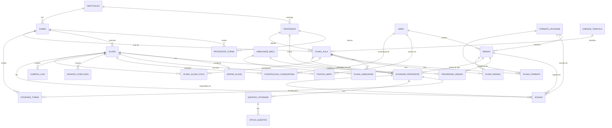

# Modelo de dados

Banco PostgreSQL (UTF-8) da API do Modolume. O esquema fica em `apps/api/prisma/schema.prisma`, e as mudanças são feitas por **migrações versionadas** em `apps/api/prisma/migrations` (ADR 0016). São 27 tabelas, 41 chaves estrangeiras e 24 restrições `CHECK`.

## Organização

| Grupo | Tabelas mães | Tabelas filhas |
| --- | --- | --- |
| 1. Catálogos | `formato_atividade`, `mapa`, `habilidade_bncc`, `unidade_tematica` | `missao` (filha de mapa e de formato) |
| 2. Escola | `instituicao` | `professor`, `turma`, `professor_turma` (vínculo N:N), `aluno` |
| 3. Aluno | `aluno` | `avatar_aluno` (1:1), `progresso_missao`, `pontos_mapa`, `constelacao_conquistada`, `desafio_concluido`, `compra_loja` |
| 4. Histórico | `aluno`, `missao`, `atividade_professor`, `formato_atividade` | `jogada` |
| 5. Atividades | `atividade_professor` | `atividade_turma` (N:N com turma), `questao_atividade` → `opcao_questao` |
| 6. Planejamento | `plano_aula` | `plano_habilidade`, `plano_formato`, `plano_missao`, `plano_aluno_foco` |

## Diagrama de entidades

## Dicionário de dados

### 1. Catálogos

| Tabela | Chave | Colunas principais | Observação |
| --- | --- | --- | --- |
| `formato_atividade` | `id` | `rotulo` | Associação visual, montagem, sequência, objetiva, completar, manipulação, exploração 3D. |
| `mapa` | `numero` | `titulo`, `constelacao` (única) | Os 8 mapas do app. |
| `missao` | `id` | `mapa_numero` → mapa, `formato_id` → formato, `titulo`, `conteudo`, `ordem` | As 28 missões de mapeamento; `(mapa_numero, ordem)` é único. |
| `habilidade_bncc` | `codigo` | `resumo` | Habilidades usadas em atividades e planos. |
| `unidade_tematica` | `nome` | — | Números, Álgebra, Geometria, Grandezas e medidas, Probabilidade e estatística. |

Os catálogos são carregados do núcleo (`packages/core`) pelo seed, que os atualiza a cada execução.

### 2. Escola

| Tabela | Chave | Colunas principais | Observação |
| --- | --- | --- | --- |
| `instituicao` | `id` | `nome`, `criado_em` | Escola. |
| `professor` | `id` | `instituicao_id`, `nome`, `email` (único, minúsculo), `senha_hash` (bcrypt), `papel` (`professor`, `coordenacao` ou `admin`), `disciplina` (só professor), `ativo`, `senha_provisoria`, `ultimo_acesso` | Guarda toda a equipe da escola (ADR 0019). Desativar, não excluir (RN-16). |
| `turma` | `id` | `instituicao_id`, `nome`, `serie`, `periodo` (enum), `ano_letivo`, `codigo` (único, `[A-Z0-9]{4,10}`), `ativa` | Código da turma (organização interna); o aluno entra com o código pessoal (ADR 0017). |
| `professor_turma` | `(professor_id, turma_id)` | `responsavel`, `desde` | Uma turma pode ter mais de um professor (MOD-TUR-003). |
| `aluno` | `id` | `turma_id`, `nome`, `matricula`, `ativo`, `luzes_gastas`, `codigo_acesso` (único, 8 caracteres sem O/0/I/1/L), `pin_hash` (bcrypt, nulo até o 1º acesso), `pin_falhas` (0 a 10), `bloqueado_ate`, `versao_acesso` (≥ 1), `ultimo_acesso` | `(turma_id, matricula)` é único. Acesso ao app pelo código pessoal + PIN (ADR 0017); um código novo aumenta a `versao_acesso` e derruba as sessões antigas. Sem e-mail, telefone ou foto (MOD-SEG-009). |

| `registro` | `id` (sequencial) | `instituicao_id`, `usuario_id`, `usuario_nome`, `papel`, `acao`, `alvo_tipo`, `alvo_id`, `detalhe`, `criado_em` | Registro de atividades (auditoria, ADR 0019). Só cresce: o usuário da API inclui e lê, mas não altera nem apaga. |

### 3. Aluno (tabelas filhas)

| Tabela | Chave | Colunas principais | Observação |
| --- | --- | --- | --- |
| `avatar_aluno` | `aluno_id` | `pele`, `cabelo`, `cor_cabelo`, `olhos`, `boca`, `acessorio`, `fundo`, `capa`, `svg` | 1:1 com o aluno; o painel mostra o `svg`. O SVG precisa começar com `<svg`. |
| `progresso_missao` | `(aluno_id, missao_id)` | `estrelas` (0–3), `vezes`, `melhor_acerto` (0–100) | Melhor resultado em cada missão. |
| `pontos_mapa` | `(aluno_id, mapa_numero)` | `pontos` (≥ 0) | Pontos de luz por mapa (RN-02, RN-03). |
| `constelacao_conquistada` | `(aluno_id, mapa_numero)` | `data` | Álbum de constelações (RN-04). |
| `desafio_concluido` | `(aluno_id, data)` | `missao_id` | Um desafio por dia (RN-11). |
| `compra_loja` | `(aluno_id, item_id)` | `comprada_em` | Itens permanentes (RN-10). |

O app envia o progresso e a API **junta** com o do banco: fica sempre o maior valor e a união das conquistas, então um aparelho desatualizado nunca apaga o que o aluno conquistou em outro.

### 4. Histórico

| Tabela | Chave | Colunas principais | Observação |
| --- | --- | --- | --- |
| `jogada` | `id` (gerado no aparelho) | `aluno_id`, `origem` (`mapa` ou `professor`), `missao_id`, `atividade_id`, `formato_id`, `titulo`, `rodadas`, `acertos_de_primeira`, `tentativas`, `percentual_conclusao`, `percentual_acerto`, `tempo_segundos`, `estrelas`, `dicas`, `data`, `recebida_em` | Base de toda a análise de aprendizagem. O id do aparelho evita duplicar (MOD-CON-003). Os dias de luz são calculados a partir das datas das jogadas. |

### 5. Atividades do professor

| Tabela | Chave | Colunas principais | Observação |
| --- | --- | --- | --- |
| `atividade_professor` | `id` | `professor_id`, `titulo`, `formato`, `instrucao`, `habilidade_codigo`, `missao_id` (só "pronta"), `plano_id`, `liberar_em`, `status` (enum), `enviada_em` | Mãe das questões. |
| `atividade_turma` | `(atividade_id, turma_id)` | — | Turmas que recebem a atividade. |
| `questao_atividade` | `id` | `atividade_id`, `ordem`, `tipo` (enum), `comando`, `enunciado` (objetiva), `texto` (completar) | `(atividade_id, ordem)` é único. |
| `opcao_questao` | `id` | `questao_id`, `ordem`, `texto`, `par`, `correta` | Alternativas (objetiva), pares (associação, `texto` ↔ `par`) ou itens na ordem certa (sequência). |

### 6. Planejamento

| Tabela | Chave | Colunas principais | Observação |
| --- | --- | --- | --- |
| `plano_aula` | `id` | `professor_id`, `turma_id`, `data`, `horario`, `aulas` (1–10), `tema`, `unidade` → unidade_tematica, `objetivos`, `conteudos`, `metodologia`, `recursos`, `avaliacao`, `observacoes`, `status` (enum), `registro` | Mãe dos itens do plano. |
| `plano_habilidade` | `(plano_id, habilidade_codigo)` | — | Habilidades da BNCC da aula. |
| `plano_formato` | `(plano_id, formato_id)` | — | Formatos de atividade escolhidos. |
| `plano_missao` | `(plano_id, missao_id)` | — | Missões do app que serão aplicadas. |
| `plano_aluno_foco` | `(plano_id, aluno_id)` | — | Alunos acompanhados; a API só aceita alunos da turma do plano (RN-23). |

## Regras de exclusão

| Situação | Regra | Por quê |
| --- | --- | --- |
| Excluir aluno, missão ou formato com jogadas | **Bloqueado** (`RESTRICT`) | O histórico de aprendizagem nunca é apagado em cascata. Alunos são desativados (`ativo = false`). |
| Excluir atividade do professor | Questões, opções e vínculos com turmas vão junto (`CASCADE`); as jogadas ficam, sem o vínculo (`SET NULL`, com o título guardado na jogada) | O professor pode limpar a lista sem apagar o que os alunos fizeram. |
| Excluir plano de aula | Habilidades, formatos, missões e alunos do plano vão junto; as atividades ficam, sem o vínculo | Idem. |
| Excluir aluno sem histórico | Avatar e progresso vão junto | São partes do aluno. |

## Segurança

- **Integridade no próprio banco:** chaves estrangeiras, unicidade, tipos `ENUM` e de data, e restrições `CHECK` (percentuais de 0 a 100, estrelas de 1 a 3, acertos de primeira ≤ rodadas, jogada de mapa sempre com missão, atividade pronta sempre com missão, plano com 1 a 10 aulas, horário `HH:MM`, código da turma, código de acesso do aluno no alfabeto permitido, contador de PINs errados de 0 a 10, e-mail minúsculo, avatar que começa com `<svg`). Foram testadas com tentativas de gravação inválidas direto no banco: todas recusadas.
- **Acesso pela API:** toda consulta é recortada pelo vínculo professor ↔ turma ou pela turma do aluno; as referências enviadas (turmas, alunos, habilidades, missões, planos) são conferidas antes de gravar.
- **Senhas:** só o hash bcrypt fica no banco; a comparação roda mesmo para e-mails inexistentes (o tempo de resposta não revela quais e-mails existem).
- **Limites:** 10 tentativas de login por minuto; 240 requisições por minuto no geral; corpo das requisições de no máximo 512 KB.
- **Privilégio mínimo em produção:** `apps/api/prisma/sql/papel-da-api.sql` cria o usuário `modolume_api`, que só lê e grava dados (sem `CREATE`, `ALTER`, `DROP` ou `TRUNCATE`). As migrações rodam com o administrador.
- **Codificação:** UTF-8 (o banco local de desenvolvimento também é criado em UTF-8, como o do Railway).
- **Dados de menores:** o aluno não tem e-mail, telefone, endereço nem foto; o avatar é um desenho (MOD-SEG-009).

## Como alterar o banco

1. Altere `apps/api/prisma/schema.prisma`.
2. `pnpm --filter @modolume/api db:nova-migracao` (gera o SQL em `prisma/migrations`, sem aplicar). Restrições `CHECK` novas são acrescentadas à mão nesse SQL.
3. Revise o SQL e aplique: `pnpm --filter @modolume/api db:migrar` (usa a `DIRECT_URL`, do administrador; a API
   roda com o usuário `modolume_api`, que não altera tabelas).
4. Nunca use `prisma migrate reset` nem `db push` no banco do Railway: eles apagam ou alteram dados sem histórico.
