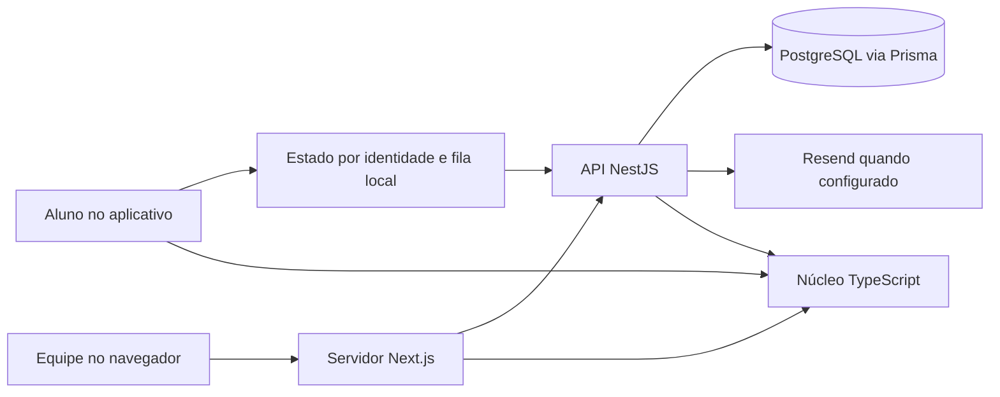

# Arquitetura do Modolume

O aplicativo Expo atende o aluno. A web Next.js atende a equipe escolar e apresenta o site público. A API NestJS valida operações e aplica permissões. O PostgreSQL mantém o histórico institucional. O núcleo TypeScript reúne catálogo, cálculos e validações que podem ser compartilhados sem depender da interface ou do banco.

| Área | Organização e responsabilidade |
| --- | --- |
| `apps/mobile/src` | Rotas Expo em `app`, apresentação em `componentes`, identidade, fila e progresso em `estado`. O servidor recebe jogadas com ID de origem local. |
| `apps/web` | Rotas e ações Next em `app`, interface em `components`, sessão e integração em `lib`. A API recebe o JWT por chamada do servidor Next. O navegador usa cookie assinado e `HttpOnly`. |
| `apps/api/src` | Controladores por perfil. `infra.ts` reúne autenticação, validação e auditoria. `credencial.ts` trata senha e entrega do link. `jogada.ts` valida o resultado e os vínculos. `conversao.ts` adapta o modelo persistido para os contratos. |
| `apps/api/prisma` | Modelo relacional, migrações versionadas e papel de execução. O cliente de execução tem privilégio menor que o usuário de migração. |
| `packages/core/src` | Catálogo e regras de jogo, análise, indicadores, esquemas compartilhados e dados de demonstração para desenvolvimento. |

O monorepo anterior já separava as aplicações, o núcleo e o banco. A mudança extraiu validações de jogadas e credenciais dos controladores, acrescentou validações compartilhadas de data, busca e paginação e moveu a gravação de auditoria para as transações das operações que a produzem. O núcleo passou a usar nomes como `ProvedorDados`, `ProvedorDadosDemonstracao`, `esquemaPlano`, `indicador.ts` e `formato.ts`.

## Convenções

- Nomes próprios da aplicação em português do Brasil, sem acentos em identificadores. Use `PascalCase` para tipos e componentes, `camelCase` para funções e propriedades, e `kebab-case` para arquivos de domínio.
- Modelos e tabelas no singular. O PostgreSQL usa `snake_case` e o Prisma mapeia nomes físicos com `@map` e `@@map`.
- Nomes de arquivos exigidos por Next e Expo seguem os frameworks. A versão atual preserva rotas já consumidas e chaves JSON existentes. Identificadores legados como `status` e diretórios `components` e `lib` ainda constam no inventário de padronização.
- Alteração de schema exige migração versionada, teste de atualização e revisão das referências. Os PRDs originais são a fonte dos critérios. Mudanças no código e evidências ficam na documentação de engenharia.

## Acesso e recuperação

A equipe entra com e-mail e senha. O banco guarda hash bcrypt. O JWT de equipe dura 8 horas e contém a versão da credencial. Troca, redefinição, revogação, mudança de papel ou desativação invalidam sessões anteriores. A migração exige um novo login de equipe porque o token anterior não tinha a versão. O aluno continua usando código pessoal e PIN.

Em `/redefinir-senha`, a pessoa solicita um link para o e-mail cadastrado. A API guarda o resumo SHA-256 de um valor aleatório de 256 bits e o prazo. A confirmação atualiza a senha, consome o resumo e registra o evento em uma transação. O novo token segue no fragmento da URL. O administrador pode revogar a credencial quando o canal de e-mail estiver configurado. Pode ajustar o e-mail durante o cadastro inicial. Depois de definida a senha, o e-mail é protegido contra alteração administrativa, inclusive após revogação.

Configure na API `RESEND_API_KEY`, `EMAIL_REMETENTE` em domínio verificado e `WEB_URL` apontando para a origem confiável da web. `REDEFINICAO_MINUTOS` aceita inteiros de 5 a 60 e tem padrão 30. Em produção a origem exige HTTPS. O fluxo responde com indisponibilidade se faltarem variáveis. O [contrato de envio do Resend](https://resend.com/docs/api-reference/emails/send-email) foi exercitado com resposta simulada. A [orientação de recuperação da OWASP](https://cheatsheetseries.owasp.org/cheatsheets/Forgot_Password_Cheat_Sheet.html) fundamenta o uso único, o prazo e a revogação.

## Envio de jogadas

O app mantém uma fila separada por identidade e não aplica respostas que chegaram depois da troca de conta. O servidor valida data, resultado e referência a uma missão ou atividade da turma. Lotes retornam `recebidas` e `recusadas`. Um ID só é confirmado se existir no histórico do próprio aluno. O app guarda recusas em uma área separada, informa o aluno e deixa pendente o que não recebeu confirmação nem recusa.

Atividades recolhidas continuam aceitando resultados offline quando o vínculo e o formato ainda correspondem. Atividade excluída ou desvinculada gera recusa. A auditoria preservou esse recorte e deixou a política histórica de prazo e revisão da atividade para decisão de produto.

## Operação e verificação

Execute as suítes de cada pacote, `pnpm -r typecheck`, `pnpm -r lint` e a build web. `pnpm --filter @modolume/api test:banco` cria um PostgreSQL descartável em `tmp/auditoria-banco-*` e usa apenas dados sintéticos. A API usa `DATABASE_URL` com `modolume_api` e `DIRECT_URL` para migrações. Configure `API_URL` e os segredos do ambiente web antes de iniciar em produção. A demonstração sem API fica restrita ao desenvolvimento.

Antes de aplicar uma migração a uma base institucional, valide o backup, o destino de `DIRECT_URL` e os privilégios efetivos do papel em homologação. O ambiente real precisa de teste de HTTPS, entrega de e-mail, fluxos móveis e carga, conforme a [matriz](matriz.md).
